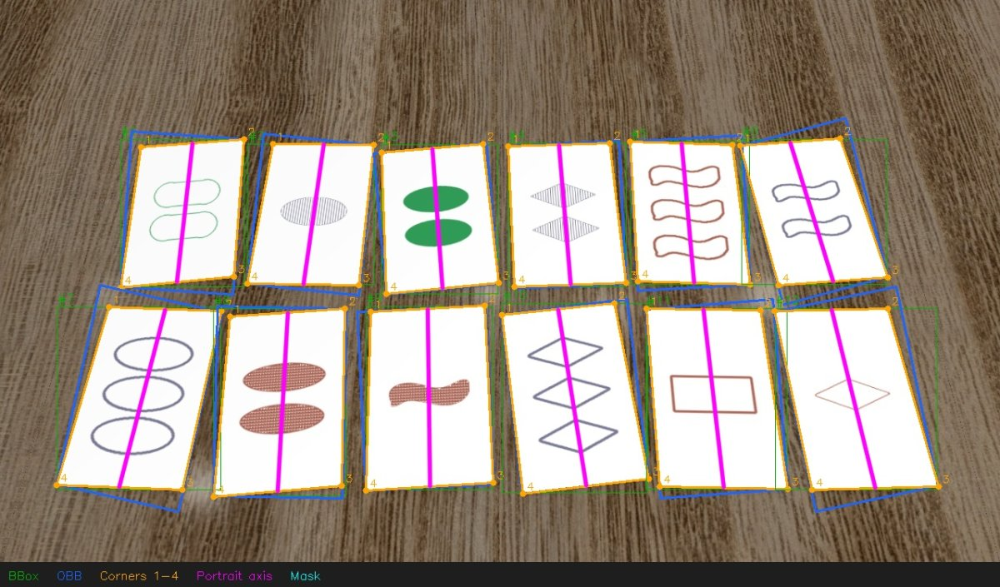
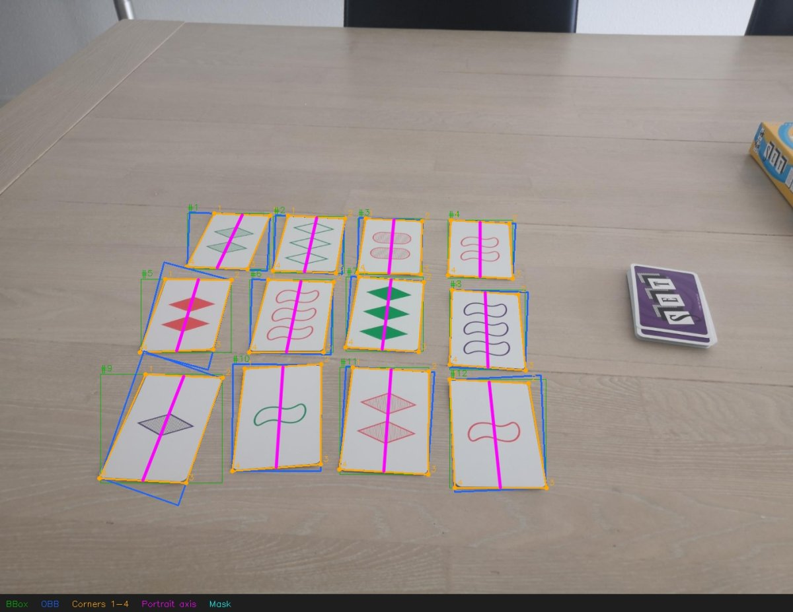
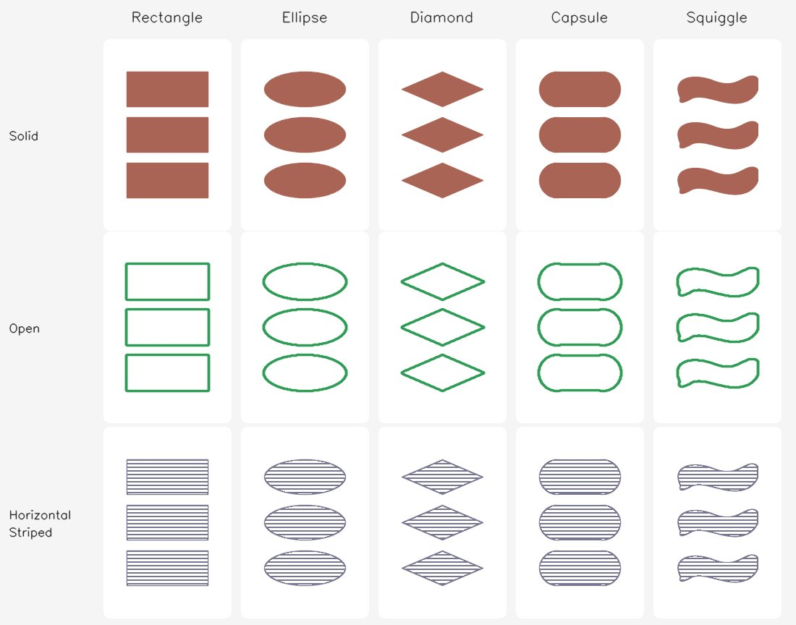
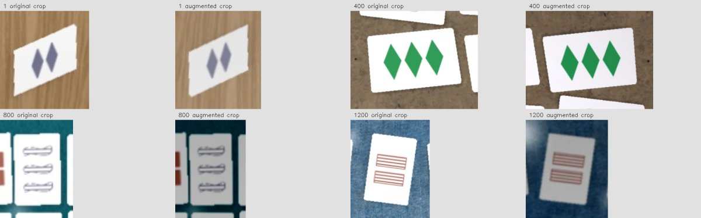

# Set Master

Generate synthetic SET cards, train card detectors, and inspect their predictions
on real photos. Detection uses a frozen DINOv3 ConvNeXt Tiny backbone with trainable
heads for boxes, oriented boxes, corner heatmaps, quadrilaterals, semantic masks, or instance masks.

## A look at the project

| Synthetic training scenes | Real card annotations |
| --- | --- |
|  |  |
| A dense card layout on a wood-grain tabletop viewed in perspective, with exact geometry from rendering. | Reviewed corner labels preserve portrait orientation under perspective. |

The purple line joins the midpoints of the card's short sides. It shows the
portrait axis, allowing 180° symmetry while distinguishing sideways crops.
These overlays show dataset annotations; evaluation overlays compare green
ground truth with red predictions.

| Card styles | Augmentation previews |
| --- | --- |
|  |  |
| Adjustable shapes, colors, shading, symbol spacing, and rounded corners. | Paired crops reveal the effects of lighting, perspective, and camera augmentation. |

## Get started

```sh
uv sync --extra training
git submodule update --init --recursive
```

Place the pretrained weights at
`models/dinov3_convnext_tiny_pretrain_lvd1689m-21b726bb.pth` and select the
project's `.venv` kernel in Jupyter.

The notebooks cover the workflow from card design to evaluation:

| Notebook | Purpose |
| --- | --- |
| [Tweak features](notebooks/tweak_features.ipynb) | Preview card geometry, symbols, and shading |
| [Download backgrounds](notebooks/download_backgrounds.ipynb) | Download and review tabletop backgrounds |
| [Generate synthetic dataset](notebooks/generate_synthetic_dataset.ipynb) | Render scenes, masks, and COCO annotations |
| [Augmentation benchmark](notebooks/benchmark_augmentations.ipynb) | Compare lighting and camera effects |
| [Train card detector](notebooks/train_card_detector.ipynb) | Configure and train the detector variants |
| [Evaluate card detector](notebooks/evaluate_card_detector.ipynb) | Inspect metrics, prediction overlays, and rectified crops |

Semantic segmentation predicts one foreground mask for all cards. Instance
segmentation predicts a separate mask for each card, including touching cards.
Both use the same frozen DINOv3 backbone with compact 128-channel mask heads.
Select `SEMANTIC` or `INSTANCE` in the training notebook, or use
`--variant semantic` / `--variant instance` in the training script. Semantic
checkpoints use foreground IoU; instance checkpoints use mask mAP.

## Data and outputs

| Location | Contents |
| --- | --- |
| `images/` | Reference photos and editable labels in `reference_cards.json` |
| `data/synthetic_datasets/` | Generated training and validation runs |
| `data/backgrounds/tabletops/` | Downloaded backgrounds and attribution |
| `data/testset/` | Exported real evaluation data |
| `runs/` | Checkpoints, metrics, previews, and evaluation overlays |

Real labels cover fully visible face-up cards; deck tops and partial cards are
excluded.

Rebuild the real testset from the reviewed source annotations:

```sh
uv run scripts/export_reference_testset.py
```

## Local experiment tracking

With Docker and Compose installed, start W&B with `docker compose up -d`.
Open [localhost:8080](http://localhost:8080), create an account, and activate it
with a license from [W&B Deployer](https://deploy.wandb.ai/deploy). Then log in:

```sh
uv run --extra training wandb login --host http://localhost:8080
```

The training notebook links to the run dashboard. Server data persists across
`docker compose down`.

## Visual checks

```sh
uv run pytest tests/visuals
```

Rendered card grids and dataset examples are saved to `tests/output/cards/` and
`tests/output/dataset_example/`, overwriting previous outputs.
