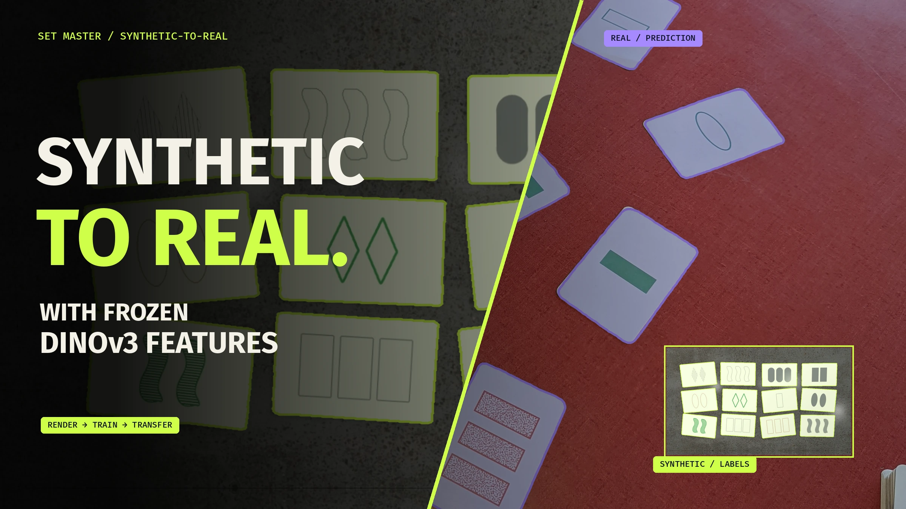
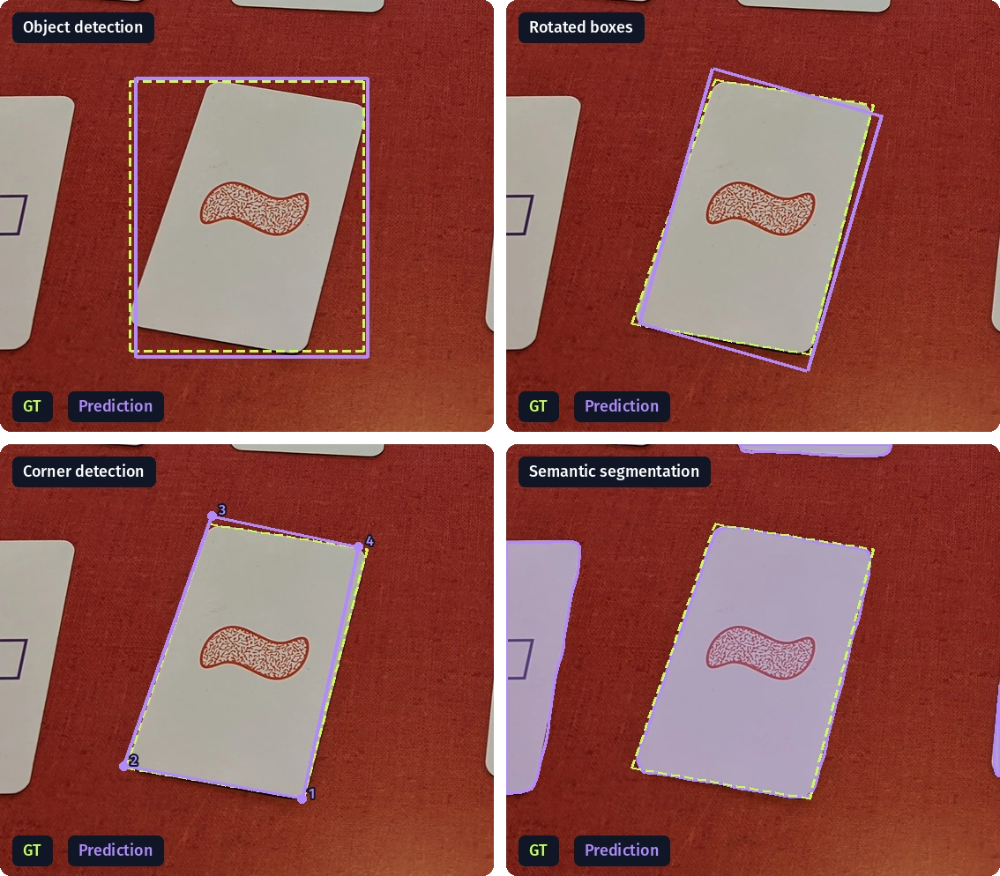
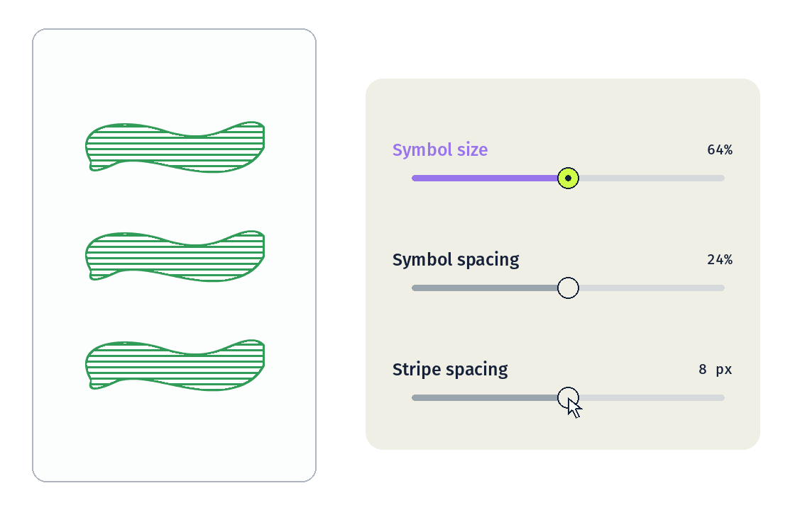
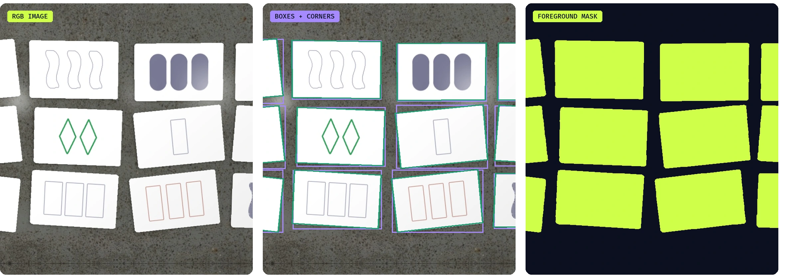

# Set Master



Generate synthetic SET cards, train card detectors, and inspect their predictions
on real photos. Detection uses a frozen DINOv3 ConvNeXt Tiny backbone with trainable
heads for boxes, oriented boxes, corner heatmaps, quadrilaterals, semantic masks, or instance masks.

## From synthetic cards to real detections

Train on procedurally generated cards, then evaluate on real photos. The frozen
backbone supplies pretrained features; the feature pyramid and task heads learn
card localization using only synthetic training data.

<p align="center">
  
</p>

*A successful example from each of four trained models on the same real card.
Lime dashed outlines show ground truth; violet shows predictions. These are
focused crops; neighboring detections are omitted in the box and corner panels.*

## Build the data, get the labels

Adjust symbol shapes, colors, shading, count, spacing, and card geometry before
placing the cards on textured tabletops with perspective and lighting variation.

<p align="center">
  
</p>

Each rendered scene supplies its own geometry and pixel labels, so the same
dataset supports multiple prediction targets without manual annotation.



## Get started

```sh
uv sync --extra training
git submodule update --init --recursive
```

Place the pretrained weights at
`models/dinov3_convnext_tiny_pretrain_lvd1689m-21b726bb.pth` and select the
project's `.venv` kernel in Jupyter.

The notebooks cover the workflow from card design to evaluation:

| Notebook | Purpose |
| --- | --- |
| [Tweak features](notebooks/tweak_features.ipynb) | Preview card geometry, symbols, and shading |
| [Download backgrounds](notebooks/download_backgrounds.ipynb) | Download and review tabletop backgrounds |
| [Generate synthetic dataset](notebooks/generate_synthetic_dataset.ipynb) | Render scenes, masks, and COCO annotations |
| [Augmentation benchmark](notebooks/benchmark_augmentations.ipynb) | Compare lighting and camera effects |
| [Train card detector](notebooks/train_card_detector.ipynb) | Configure and train the detector variants |
| [Evaluate card detector](notebooks/evaluate_card_detector.ipynb) | Inspect metrics, prediction overlays, and rectified crops |

Semantic segmentation predicts one foreground mask for all cards. Instance
segmentation predicts a separate mask for each card, including touching cards.
Both use the same frozen DINOv3 backbone with compact 128-channel mask heads.
Select `SEMANTIC`, `SEMANTIC_REFINED`, or `INSTANCE` in the training notebook,
or use `--variant semantic`, `--variant semantic_refined`, or
`--variant instance` in the training script. Semantic
checkpoints use foreground IoU; instance checkpoints use mask mAP.

`SEMANTIC_REFINED` progressively corrects a coarse mask using finer FPN features
and small RGB branches at half and full input resolution. Every stage learns
from a target at its own resolution, with boundary-weighted BCE, Dice, and
pyramid consistency losses. The DINO backbone stays frozen. Refinement runs
within the configured image size limits; it uses one image scale per forward
pass and requires more activation memory than the basic semantic head.

## Data and outputs

| Location | Contents |
| --- | --- |
| `images/` | Reference photos and editable labels in `reference_cards.json` |
| `data/synthetic_datasets/` | Generated training and validation runs |
| `data/backgrounds/tabletops/` | Downloaded backgrounds and attribution |
| `data/testset/` | Exported real evaluation data |
| `runs/` | Checkpoints, metrics, previews, and evaluation overlays |

Real labels cover fully visible face-up cards, deck tops and partial cards are
excluded.
Reference filenames use `scene_005_001.jpg`: the first number identifies the
scene, and the second identifies a photo within that scene.

Rebuild the real testset from the reviewed source annotations:

```sh
uv run scripts/export_reference_testset.py
```

## Local experiment tracking

With Docker and Compose installed, start W&B with `docker compose up -d`.
Open [localhost:8080](http://localhost:8080), create an account, and activate it
with a license from [W&B Deployer](https://deploy.wandb.ai/deploy). Then log in:

```sh
uv run --extra training wandb login --host http://localhost:8080
```

The training notebook links to the run dashboard. Server data persists across
`docker compose down`.

## Visual checks

```sh
uv run pytest tests/visuals
```

Rendered card grids and dataset examples are saved to `tests/output/cards/` and
`tests/output/dataset_example/`, overwriting previous outputs.
